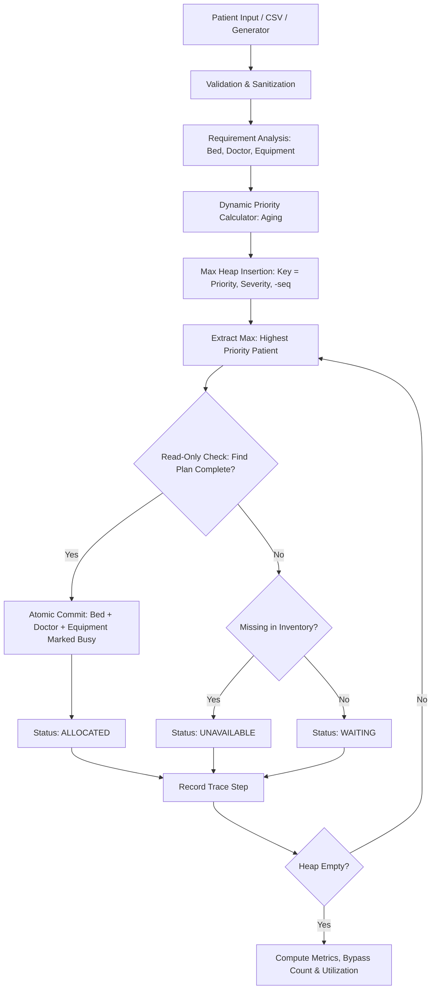
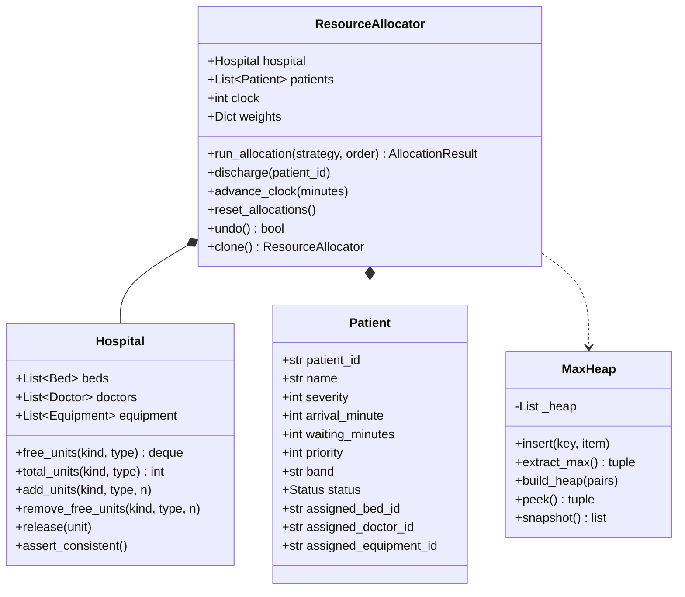
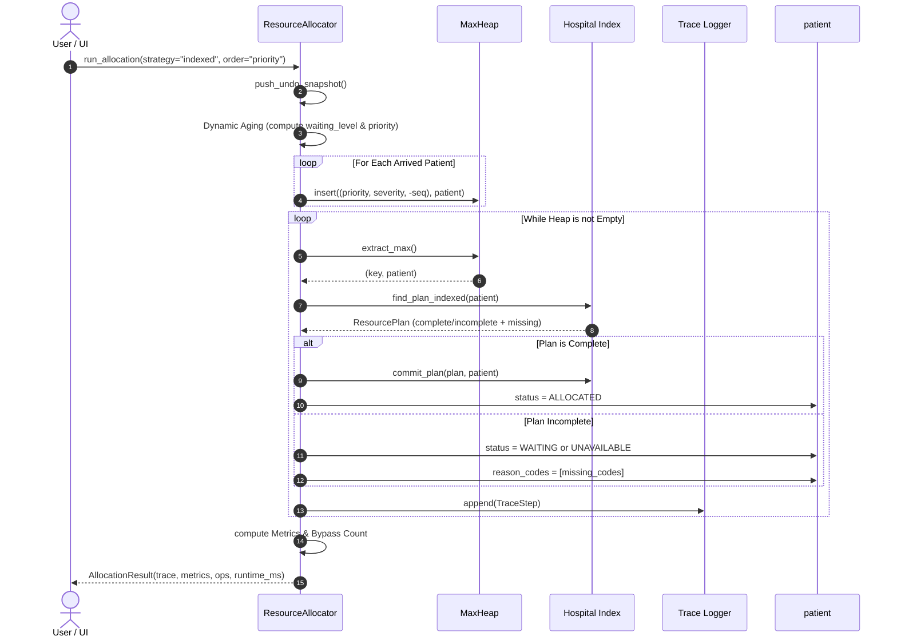

# System Architecture & Technical Design

## 1. Architectural Principles
1. **Strict Separation of Concerns:** Algorithm and data structure layers (`algorithms/`, `models/`, `utils/`) are purely computational and never import UI libraries.
2. **Deterministic Execution:** The same input state yields bit-for-bit identical allocation decisions, traces, and metrics on every run.
3. **Immutability of Analysis:** What-If scenarios, Resource Advisor evaluations, and benchmark passes operate strictly on cloned state, guaranteeing the live hospital state is never mutated during speculative execution.
4. **Resilient Domain Typing:** All error conditions raise `DomainError` with descriptive, actionable diagnostics rather than failing with generic exceptions.

---

## 2. Component Pipeline Flowchart

---

## 3. Class Diagram

---

## 4. Run Allocation Sequence Diagram

